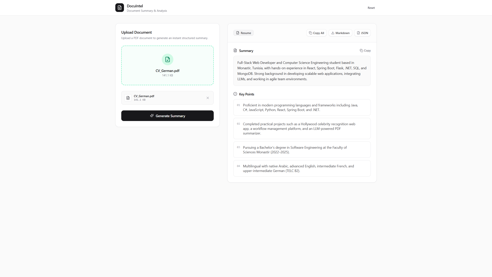
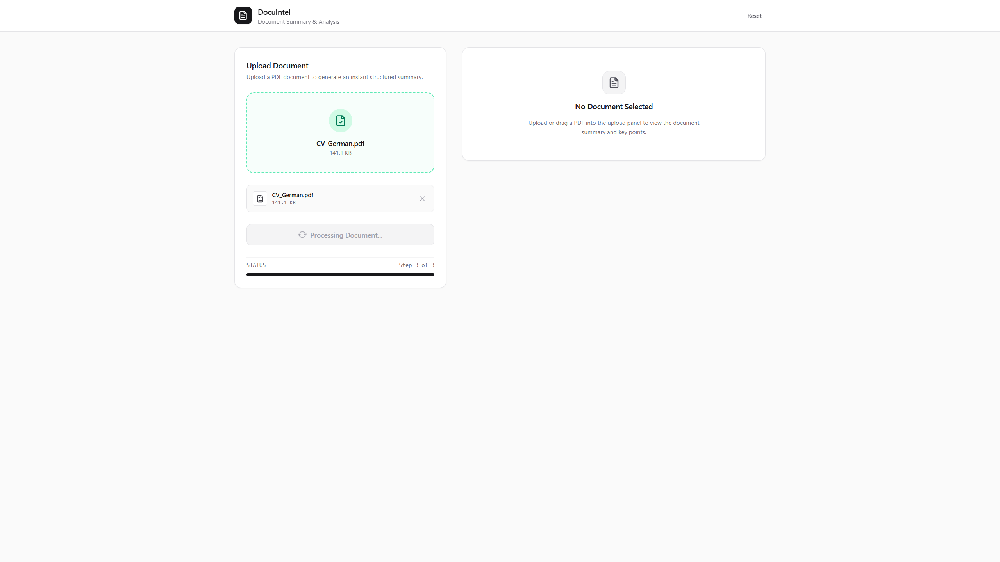
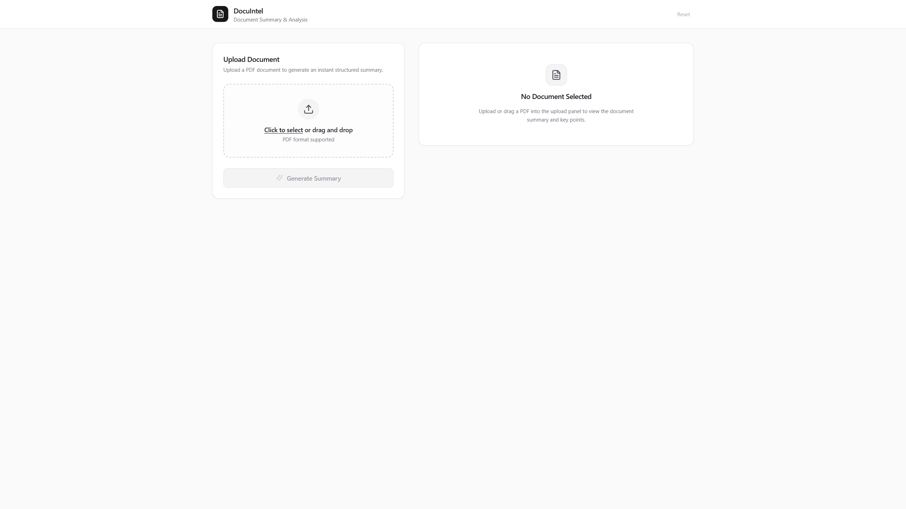

# DocuIntel — Intelligent PDF Document Analysis & Summarization

[](https://dotnet.microsoft.com/)
[](https://react.dev/)
[](https://www.typescriptlang.org/)
[](https://vitejs.dev/)
[](https://tailwindcss.com/)
[](https://ai.google.dev/)
[](https://python.org/)

An enterprise-grade, full-stack document intelligence application. Upload any PDF document to automatically classify its taxonomy (e.g., Insurance Policy, Healthcare Record, Business Invoice) and generate executive summaries and structured key findings powered by **Google Gemini 3.5**.

---

## Screenshots

### 1. Document Analysis Workspace
> Complete executive summary, taxonomy badge, structured takeaways, and instant export options (Markdown, JSON, Clipboard).



---

### 2. Document Ingestion & Upload
> Drag-and-drop PDF dropzone with real-time size validation and multi-step pipeline status.



---

### 3. Pipeline Ingestion & Heuristics
> Clean processing states with automatic detection and graceful handling for empty or scanned non-text documents.



---

## Architecture Overview

```
┌────────────────────────────────────────────────────────┐
│               React + Vite Frontend (UI)               │
│   • Drag-and-drop PDF Ingestion                        │
│   • Real-time Multi-step Processing Stepper            │
│   • Taxonomy Badging & Executive Summary Display       │
│   • One-click Export to Markdown & JSON                │
└───────────────────────────┬────────────────────────────┘
                            │ HTTP POST (multipart/form-data)
                            ▼
┌────────────────────────────────────────────────────────┐
│             ASP.NET Core 8 Web API (Backend)           │
│   • File stream validation (type, size <= 10MB)        │
│   • Secure temporary file management (GUID-based)      │
│   • Process orchestration (spawns Python worker)       │
│   • Serves static SPA dist assets in production        │
└───────────────────────────┬────────────────────────────┘
                            │ CLI Invocation (process_pdf.py)
                            ▼
┌────────────────────────────────────────────────────────┐
│            Python Document Extraction Worker           │
│   • PDF Stream Text Extraction (pypdf)                 │
│   • Domain Taxonomy Classifier (Insurance/Medical/Gen) │
│   • Tier 1: Google Gemini 3.5 Flash / Flash-Lite API   │
│   • Tier 2: OpenAI GPT-4.1-mini Fallback               │
│   • Tier 3: Local Rule-Based Lexical Extractor         │
└────────────────────────────────────────────────────────┘
```

---

## Key Features

- **Multi-Model LLM Resilience**:
  - Primary: **Google Gemini 3.5 Flash** (via the official `google-genai` SDK) for fast, structured document analysis.
  - Secondary: **OpenAI GPT-4.1-mini** fallback if Gemini is unreachable.
  - Offline / Rule-Based: Local extraction heuristics if no API keys are present.
- **Automated Taxonomy Classification**:
  - Identifies domain types including **Health Insurance Policies**, **Clinical Healthcare Records**, and **General Invoices/Documents**.
- **Modern Enterprise Interface**:
  - Clean, distraction-free neutral palette inspired by modern developer platforms (Linear, Stripe, Vercel).
  - Responsive layout built with Tailwind CSS v4, Lucide icons, and Radix UI primitives.
- **Export & Productivity Tools**:
  - One-click **Markdown** report generation and download.
  - One-click **Raw JSON** schema export.
  - Copy individual takeaway insights or the entire briefing to the clipboard.
- **Resilient File Handling**:
  - Strict validation for PDF file signature and size bounds.
  - Graceful notification when documents lack readable text layers (scanned images without OCR).
  - Cross-platform Windows file path compatibility patch for paths containing special characters (`#`).

---

## Tech Stack

| Layer | Technology | Details |
|---|---|---|
| **Frontend** | React 18, TypeScript, Vite 6 | Fast modern SPA with HMR and strict typing |
| **Styling** | Tailwind CSS v4, Lucide React | Clean, responsive, enterprise design system |
| **Backend API** | ASP.NET Core 8 (.NET 8) | High-performance C# Minimal API with CORS |
| **AI Inference** | Python 3.10+ & `google-genai` | Native Google GenAI SDK with structured JSON schemas |
| **PDF Extraction** | `pypdf`, `reportlab` | Stream parsing and testing harness |

---
This project is licensed under the [MIT License](LICENSE).
